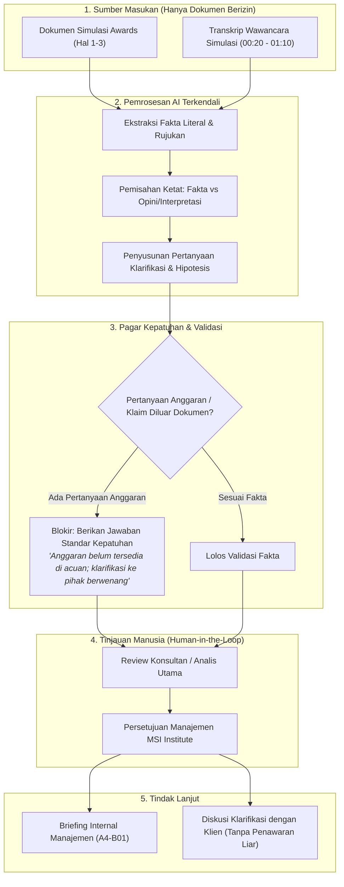

# ALUR AKSES DOKUMEN & PERSETUJUAN KEPATUHAN A4
**Kode Dokumen**: A4-S01 | **Sifat**: SIMULASI TES PRAKTIK MSI GROUP

### Keterangan Kebijakan Akses:
1. **Prinsip Least-Privilege & Data Berizin**: Agen AI tidak diberi akses ke data rahasia perusahaan atau sistem ERP klien, melainkan hanya transkrip dan lembar data simulasi resmi.
2. **Ketiadaan Penawaran Otomatis**: Hasil analisis AI tidak pernah dikirimkan langsung ke calon klien sebagai proposal. Seluruh keluaran berstatus draf internal bagi manajemen.

